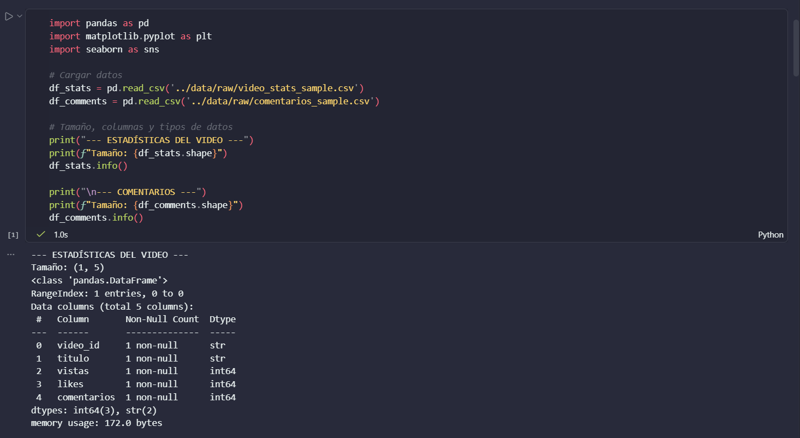
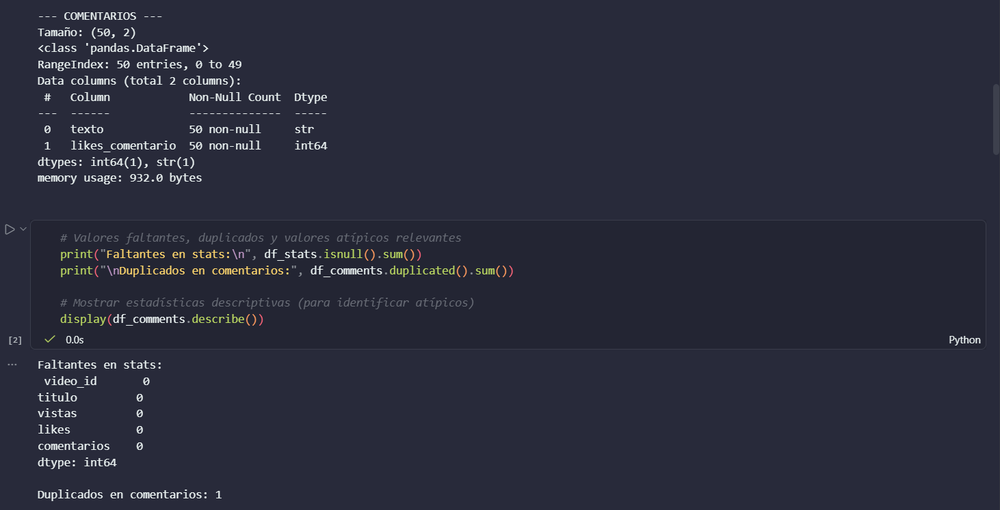
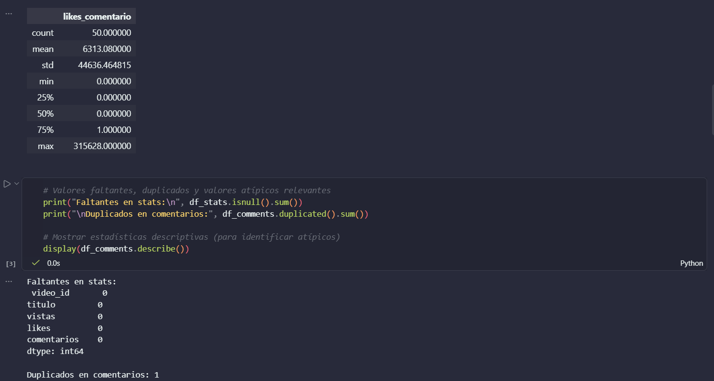
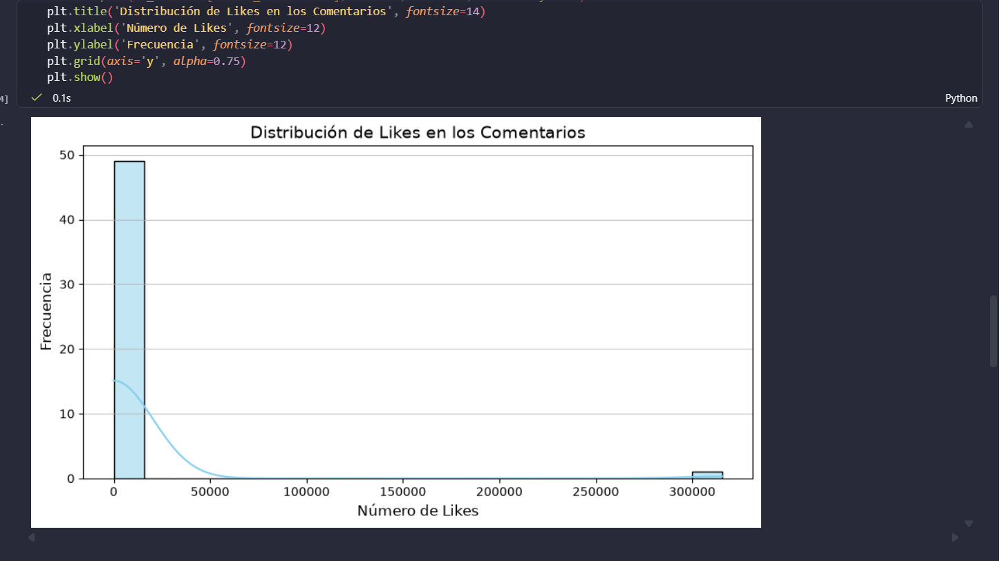
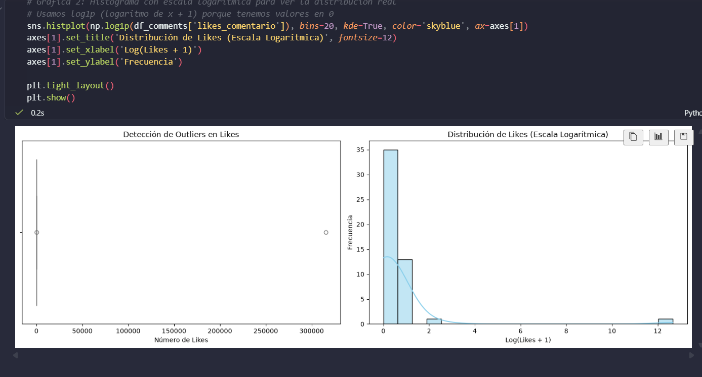
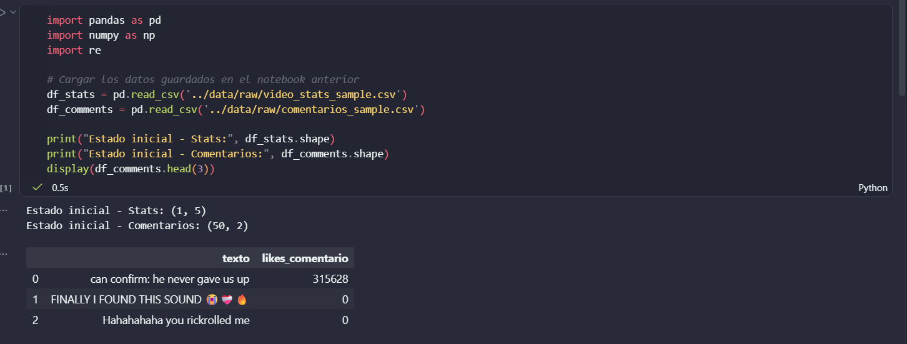
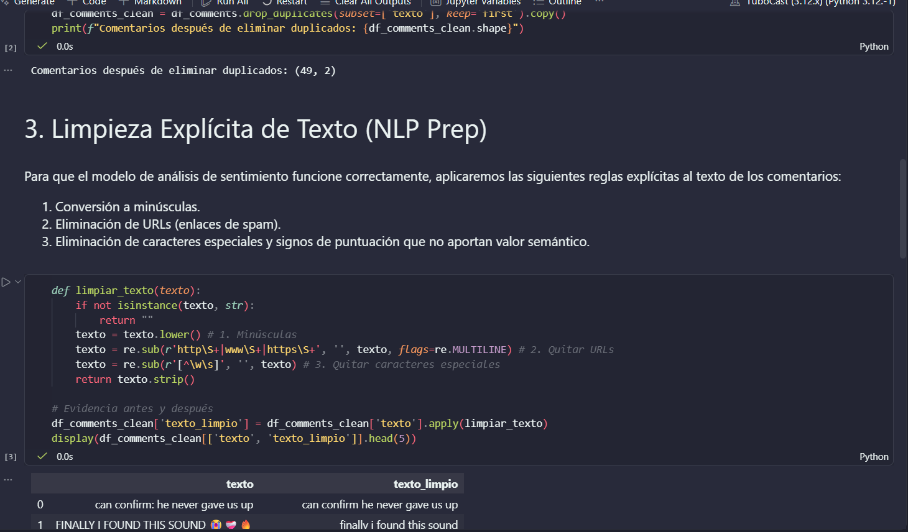

# TubeCast: vistas acumuladas por cohorte en el canal de la MLB

**Equipo**

| Integrante | Rol en la tercera entrega |
|---|---|
| Diego Eduardo Martínez Sincel | _(completar)_ |
| César Adrián Santos | _(completar)_ |
| José Manuel García | _(completar)_ |

- **Responsable de Databricks (MLflow remoto y Model Registry):** _(completar)_
- **Responsable del despliegue en EC2:** _(completar)_

## 1. Qué hace el proyecto

Al principio quisimos predecir la viralidad de videos combinando métricas tempranas con sentimiento de comentarios. Con la YouTube Data API v3 eso no se puede hacer bien: la API sólo da el conteo **actual** de vistas, no su historia. Por eso acotamos el problema a algo que sí podemos medir de forma honesta.

- **Fuente:** los ~20 000 videos más recientes del canal oficial de la MLB (YouTube Data API v3).
- **Unidad de observación:** una **cohorte diaria**, es decir, los videos publicados en un día *t*.
- **Target:** las vistas acumuladas por la cohorte *t* en la fecha de descarga *D* (una instantánea).
- **Features:** la misma medida para las 14 cohortes anteriores (`lag_14 … lag_1`), tomada en la misma instantánea.
- **Alcance:** es un **análisis retrospectivo de cohortes**, no un pronóstico en tiempo real ni una medida de las vistas que el canal recibe en un día. Descartamos las cohortes con menos de 30 días de antigüedad en *D* porque todavía no acumulan sus vistas (`DIAS_MADURACION` en `src/entrenamiento/datos.py`).

El sistema completo: descarga y preparación de datos → HPO de tres familias (Ridge, Random Forest y HistGradientBoosting) con Optuna → selección por validación y evaluación final en test → registro de tres versiones en el Model Registry de Databricks con alias `champion` → API FastAPI que sirve esa versión → interfaz Streamlit → contenedores con Docker Compose → despliegue en una instancia EC2.

Las decisiones y resultados están en el [informe final](informe/informe-final.ipynb). El mapa del sistema está en [docs/mapa-sistema-ml.md](docs/mapa-sistema-ml.md).

## 2. Estructura

```text
├── data/                       # Datos locales (ignorados en Git) y su README
├── docs/mapa-sistema-ml.md     # Mapa del sistema: local, Databricks y EC2
├── evidencia/                  # Capturas de verificación (sección 9)
├── informe/informe-final.ipynb # Síntesis end to end
├── notebooks/
│   ├── 01-eda.ipynb, 02-preparacion-datos.ipynb   # Primera entrega
│   ├── 03-experimentos.ipynb                      # Tres familias con HPO
│   ├── 04-seleccion-registro.ipynb                # Versiones y champion
│   ├── 05-pipeline.ipynb                          # Flow de Prefect
│   ├── 06-api.ipynb, 07-frontend.ipynb            # API y Streamlit
│   ├── 08-contenedores.ipynb                      # Docker y Compose
│   └── 09-despliegue.ipynb                        # EC2
├── src/
│   ├── entrenamiento/          # datos, modelos, HPO, flow de Prefect, reportes
│   ├── api/                    # FastAPI + Dockerfile
│   └── frontend/               # Streamlit + Dockerfile
├── docker-compose.yaml         # Levanta api y ui con red host
├── requirements.txt            # Exportado desde uv.lock (no se edita a mano)
├── .dockerignore  .env.example  pyproject.toml  uv.lock
```

## 3. Datos

Los datos no se suben a Git. Cómo obtenerlos, el diccionario de datos y las consideraciones de privacidad están en [data/README.md](data/README.md). El flow los descarga la primera vez si existe `YOUTUBE_API_KEY` en `.env` y después reutiliza `data/raw/mlb_raw_videos.parquet`.

## 4. Ambiente

Requiere [uv](https://docs.astral.sh/uv/). El proyecto usa Python 3.12 (`.python-version`).

```bash
uv sync --locked
```

`--locked` instala exactamente lo que dice `uv.lock` y falla si el lock no corresponde a `pyproject.toml`. Salida esperada: termina sin error y crea `.venv/`.

## 5. Configuración externa

```bash
cp .env.example .env
```

Cada persona llena su propio `.env` con sus accesos. **No se comparte ni se sube a Git** (`.gitignore` y `.dockerignore` lo excluyen). Variables principales:

| Variable | Para qué |
|---|---|
| `YOUTUBE_API_KEY` | Descargar los datos |
| `DATABRICKS_HOST`, `DATABRICKS_TOKEN` | Acceso personal al workspace de Databricks |
| `MLFLOW_TRACKING_URI=databricks`, `MLFLOW_REGISTRY_URI=databricks-uc` | Tracking y Registry remotos |
| `MLFLOW_EXPERIMENT_NAME` | `/Shared/pcd-otono-2026-proyecto-tubecast` |
| `UC_MODEL_NAME`, `MODEL_ALIAS` | `workspace.default.pcd_otono_2026_tubecast` y `champion` |
| `MODEL_SOURCE` | `registry` (predeterminado) o `local` (artefacto propio en `artifacts/`) |
| `API_HOST` | Dirección de escucha de la API en Compose (`127.0.0.1` en EC2) |

## 6. Entrenamiento (flow de Prefect)

En una terminal, el servidor local de Prefect para revisar la ejecución:

```bash
uv run prefect server start
```

En otra terminal, el flow (20 trials por familia):

```bash
uv run python -m src.entrenamiento.flow 20
```

Qué hace cada task y cómo verificarlo:

| Task | Qué revisar |
|---|---|
| `1_cargar_y_validar_datos` | Log con número de videos y rango de fechas |
| `2_preparar_serie_y_particiones` | Filas y fechas de train/val/test |
| `3_hpo_y_modelo_final_por_familia` (×3) | Runs `hpo-<familia>` con `trial-NNN` y `<familia>-final` en el experimento |
| `4_comparar_y_seleccionar` | Tabla comparativa y familia elegida por **menor `val_rmse`** |
| `5_registrar_en_registry_y_asignar_champion` | Tres versiones nuevas en `workspace.default.pcd_otono_2026_tubecast` y alias `champion` |

Salida esperada al final: `Pipeline finalizado: tres versiones registradas y alias asignado.` y el flow en estado **Completed** en `http://127.0.0.1:4200`. Si el registro remoto falla, la task 5 falla (ya no se reporta un éxito con respaldo silencioso). Además, el flow guarda `artifacts/champion_model.pkl` y `artifacts/champion_metadata.json` (ignorados en Git), que sirven de respaldo explícito.

## 7. API y frontend sin contenedores

```bash
uv run uvicorn src.api.main:app --host 127.0.0.1 --port 8000
uv run streamlit run src/frontend/app.py
```

Comprobación (otra terminal):

```bash
curl http://127.0.0.1:8000/health
```

Salida esperada (la versión depende del registro):

```json
{"status":"ok","model_loaded":true,"model_source":"registry databricks-uc: workspace.default.pcd_otono_2026_tubecast@champion -> versión N","model_name":"workspace.default.pcd_otono_2026_tubecast","model_version":"N","model_family":"...","detail":null}
```

## 8. Contenedores con Docker Compose

Nombres que usamos en todo el proyecto:

| Elemento | API | UI |
|---|---|---|
| Servicio de Compose | `api` | `ui` |
| Imagen | `tubecast-api-image:v1` | `tubecast-ui-image:v1` |
| Contenedor | `tubecast-api-container` | `tubecast-ui-container` |
| Dockerfile | `src/api/Dockerfile` | `src/frontend/Dockerfile` |
| Contexto de construcción | raíz del repo (`.`) | raíz del repo (`.`) |
| Puerto | 8000 | 8501 |

El contexto es la raíz porque la API es el paquete `src.api` y `requirements.txt` está en la raíz. `.dockerignore` deja fuera `.env`, `.venv`, `.git`, datos, modelos y notebooks; cada Dockerfile copia sólo su carpeta de `src/`.

**Red host.** Los dos servicios usan `network_mode: host`, así que comparten la red del anfitrión. Para la interfaz, `http://127.0.0.1:8000` no es "su propio contenedor": es el anfitrión, donde también escucha la API. Por eso no hay `ports` en el YAML. En Docker Desktop (Windows/macOS) hay que activar **Settings → Resources → Network → Enable host networking** (versión 4.34 o posterior).

**Dependencias.** `requirements.txt` se genera desde el lock; si cambia `uv.lock`, se regenera con:

```bash
uv export --locked --no-emit-project --no-hashes --no-dev --output-file requirements.txt
```

**Comprobación local** (desde la raíz del repo):

```bash
uv sync --locked
docker compose -f docker-compose.yaml config --quiet
docker compose -f docker-compose.yaml build
docker compose -f docker-compose.yaml up
```

En otra terminal:

```bash
docker compose -f docker-compose.yaml ps
docker compose -f docker-compose.yaml logs api
```

**Cómo saber que la API ya cargó el modelo:** en los logs aparece `Modelo cargado: registry databricks-uc: ...@champion -> versión N` seguido de `Application startup complete`, y `docker compose ps` muestra la API como `healthy` (el healthcheck consulta `/health` y exige `model_loaded: true`). Después abre `http://127.0.0.1:8501` y pulsa **Obtener Predicción**.

Para abrir `/docs` desde el navegador en Docker Desktop, pon `API_HOST=0.0.0.0` en tu `.env` local. En EC2 se queda en `127.0.0.1`.

**Detener sólo este proyecto:**

```bash
docker compose -f docker-compose.yaml down
```

`down` retira únicamente `tubecast-api-container` y `tubecast-ui-container`; conserva imágenes y archivos.

## 9. Despliegue en EC2

Usamos **una sola instancia EC2 ya asignada** a _(completar: integrante)_, en `us-east-1` (Ubuntu 24.04, t3.medium, 20 GiB gp3). El detalle y las evidencias están en [notebooks/09-despliegue.ipynb](notebooks/09-despliegue.ipynb).

**Grupo de seguridad:** SSH (22) sólo desde *My IP* del responsable; Streamlit (8501) sólo desde las IP públicas de las computadoras que prueban (`IP/32`). El puerto 8000 **no** se abre: la API escucha en `127.0.0.1` dentro del servidor.

*En EC2 (terminal SSH):*

```bash
# 1. Revisar la instancia sin tocar lo de otras actividades
df -h && free -h && sudo docker ps -a

# 2. Clonar con un token temporal de sólo lectura (se escribe cuando Git lo pide, nunca en la URL)
mkdir -p ~/proyecto && cd ~/proyecto
git -c credential.helper= clone https://github.com/cesarsantos23/TubeCast.git
cd TubeCast
git switch feat/tercera-entrega        # después del merge: git switch main && git pull
git rev-parse --short HEAD

# 3. Configuración privada (fuera de Git)
cp .env.example .env && chmod 600 .env && nano .env

# 4. Construir y arrancar
sudo docker compose -f docker-compose.yaml config --quiet
sudo docker compose -f docker-compose.yaml up --build -d
sudo docker compose -f docker-compose.yaml ps
sudo docker compose -f docker-compose.yaml logs --tail 30 api
```

**Verificación desde el servidor:**

```bash
curl http://127.0.0.1:8000/health
curl -s -o /dev/null -w "%{http_code}\n" -X POST http://127.0.0.1:8000/predict \
  -H "Content-Type: application/json" -d '{"lags_14_dias":[1,2,3]}'      # esperado: 422
```

**Predicción remota:** desde otra computadora autorizada, abrir `http://IP_PUBLICA_EC2:8501`, capturar los 14 valores y pulsar **Obtener Predicción**. La interfaz muestra la versión del modelo y en `logs api` aparece la línea `Predicción: ... | versión=N`.

**Cierre:**

```bash
sudo docker compose -f docker-compose.yaml down
exit
```

Después, en la consola de AWS: **Instance state → Stop instance** hasta ver `Stopped`, y borrar el token temporal de GitHub. Con la instancia detenida ya no se cobra cómputo, pero el volumen EBS de 20 GiB (y una IP elástica, si se hubiera asignado) sigue generando costo. No terminamos la instancia porque se reutiliza.

Si cambia tu IP pública, actualiza el origen de la regla SSH a *My IP* antes de conectarte y revisa la IPv4 pública actual de la instancia (cambia en cada arranque).

## 10. Evidencias

Cada imagen está en `evidencia/` y se interpreta en el [informe](informe/informe-final.ipynb) y en los notebooks 08 y 09.

| Caso | Archivo |
|---|---|
| Experimento remoto con tres familias | [t7-01-experimento-remoto.png](evidencia/t7-01-experimento-remoto.png) |
| HPO Ridge / Random Forest / Gradient Boosting | [ridge](evidencia/t7-02-hpo-ridge.png) · [random-forest](evidencia/t7-02-hpo-random-forest.png) · [gradient-boosting](evidencia/t7-02-hpo-gradient-boosting.png) |
| Comparación final | [t7-03-comparacion.png](evidencia/t7-03-comparacion.png) |
| Model Registry: tres versiones y `champion` | [t7-04-model-registry.png](evidencia/t7-04-model-registry.png) |
| Flow de Prefect | [t7-05-prefect.png](evidencia/t7-05-prefect.png) |
| API: entrada válida | [t7-06-api-valida.png](evidencia/t7-06-api-valida.png) |
| API: entrada inválida | [t7-07-api-invalida.png](evidencia/t7-07-api-invalida.png) |
| Frontend integrado | [t7-08-frontend.png](evidencia/t7-08-frontend.png) |
| Ambiente y builds | [t8-01-uv-sync-builds.png](evidencia/t8-01-uv-sync-builds.png) |
| Integración local en contenedores | [t8-02-integracion-local.png](evidencia/t8-02-integracion-local.png) |
| Instancia y red | [t8-03-ec2-instancia-red.png](evidencia/t8-03-ec2-instancia-red.png) |
| Despliegue en EC2 | [t8-04-ec2-despliegue.png](evidencia/t8-04-ec2-despliegue.png) |
| Predicción remota | [t8-05-prediccion-remota.png](evidencia/t8-05-prediccion-remota.png) |
| Entrada inválida en EC2 | [t8-06-ec2-entrada-invalida.png](evidencia/t8-06-ec2-entrada-invalida.png) |
| Logs | [t8-07-logs.png](evidencia/t8-07-logs.png) |
| Cierre | [t8-08-cierre.png](evidencia/t8-08-cierre.png) |

Evidencias de la primera entrega (EDA y preparación sobre un video de muestra):









## 11. Uso de IA

Usamos asistentes de IA (Claude) como apoyo para revisar el código, redactar documentación y preparar los Dockerfiles y Compose a partir de las clases 17, 19 y 20. Revisamos y ejecutamos todo lo que se entrega; los resultados que aparecen salen de nuestras propias ejecuciones.
