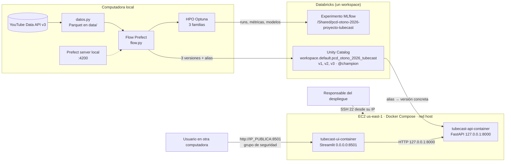

# Mapa del sistema de ML: TubeCast

Versión actualizada para la tercera entrega. La primera versión (clase 9) planteaba comentarios, sentimiento y un pronóstico por video; con los datos reales de la YouTube Data API cambiamos el alcance. Aquí queda el sistema tal como existe hoy.

## 1. Contexto

- **Decisión que apoya:** entender, en retrospectiva, cuántas vistas acumula lo que el canal de la MLB publica en un día comparado con los días cercanos (detectar cohortes atípicas, comparar periodos de la temporada).
- **Supuesto principal:** cohortes vecinas, medidas en la misma instantánea, se parecen entre sí; el patrón de las 14 anteriores informa sobre la siguiente.
- **Limitación aceptada:** la API sólo entrega el conteo acumulado actual. No reconstruimos el tráfico diario histórico ni pronosticamos en tiempo real.

## 2. Nivel de datos

| Elemento | Decisión |
|---|---|
| Fuente | YouTube Data API v3, canal oficial MLB (`channels.list`, `playlistItems.list`, `videos.list`) |
| Volumen | ~20 000 videos más recientes |
| Unidad de observación | Cohorte diaria: videos publicados en el día *t* |
| Target | Vistas acumuladas de la cohorte *t* en la fecha de descarga *D* |
| Features | Misma medida para las cohortes `t-14 … t-1` |
| Limpieza | Duplicados por `video_id`, nulos y negativos validados en el flow; días sin publicaciones = 0; se descartan las cohortes de los últimos 30 días antes de *D* |
| Particiones | Temporales 70 / 15 / 15 (train / validación / test), sin mezcla |
| Almacenamiento | Parquet local en `data/` (fuera de Git) |

## 3. Nivel del modelo

| Elemento | Decisión |
|---|---|
| Tarea | Regresión sobre ventanas de 14 lags |
| Familias | Ridge, Random Forest, HistGradientBoosting (cada una en un `Pipeline` con `StandardScaler`) |
| HPO | Optuna `TPESampler(seed=42)`, 20 trials por familia, métrica `val_rmse` |
| Selección | Menor `val_rmse`; test sólo para la evaluación final |
| Métricas reportadas | RMSE, MAE y MAPE (MAPE sólo en días con vistas > 0) |
| Baseline | Media móvil de los lags |
| Artefacto | Pipeline sklearn registrado en MLflow (firma + ejemplo de entrada), tres versiones del mismo modelo, alias `champion` |

## 4. Nivel de código

| Componente | Ubicación | Dónde corre |
|---|---|---|
| Descarga y preparación | `src/entrenamiento/datos.py` | Computadora local |
| Modelos, métricas, HPO | `src/entrenamiento/modelos.py`, `hpo.py` | Computadora local, con tracking en Databricks |
| Orquestación | `src/entrenamiento/flow.py` (Prefect, servidor local) | Computadora local |
| Consultas para notebooks | `src/entrenamiento/reportes.py` | Computadora local |
| API | `src/api/` (FastAPI) | Contenedor `tubecast-api-container` (local o EC2) |
| Interfaz | `src/frontend/` (Streamlit) | Contenedor `tubecast-ui-container` (local o EC2) |
| Ambiente | `pyproject.toml` + `uv.lock`; `requirements.txt` exportado del lock para las imágenes | — |

## 5. Interfaces (contratos)

1. **Datos → modelo:** DataFrame con columnas `lag_14 … lag_1` (float64) en ese orden. La API construye exactamente las mismas columnas, así que entrenamiento e inferencia comparten el procesamiento; el escalado viaja dentro del pipeline.
2. **Entrenamiento → Registry:** `workspace.default.pcd_otono_2026_tubecast`, versiones con etiquetas `familia`, `final_run_id`, `val_rmse`, `test_rmse`, `test_mae`; alias `champion`.
3. **Registry → API:** al arrancar, la API resuelve `champion` a un número de versión y carga `models:/workspace.default.pcd_otono_2026_tubecast/<versión>`. Respaldo explícito (`MODEL_SOURCE=local`): `artifacts/champion_model.pkl` + `champion_metadata.json`, reportado como tal.
4. **API:** `GET /health`, `POST /reload`, `POST /predict` con `{"lags_14_dias": [14 números ≥ 0]}` → `predicted_views`, `interpretation`, `model_name`, `model_version`, `model_family`, `model_source`. Entradas inválidas → 422.
5. **UI → API:** HTTP a `http://127.0.0.1:8000` (red host).

## 6. Forma de operación

- **Entrenamiento:** offline, por lotes, lanzado a mano con el flow. Se repite cuando se descargan datos nuevos.
- **Inferencia:** bajo demanda, una solicitud por formulario. La API no reentrena.
- **Despliegue:** Docker Compose con red host en una instancia EC2 existente; se enciende para demostrar y se detiene al terminar.

## 7. Patrón de serving

**Model as a Service.** El modelo vive detrás de la API; la interfaz no tiene dependencias del modelo ni credenciales. Precompute no aplica porque las 14 entradas las elige el usuario; Model-as-Dependency obligaría a meter MLflow y las credenciales en la interfaz.

## 8. Diagrama

La misma pareja de contenedores corre también en la computadora local (Docker Desktop con host networking) para la comprobación previa al despliegue.
